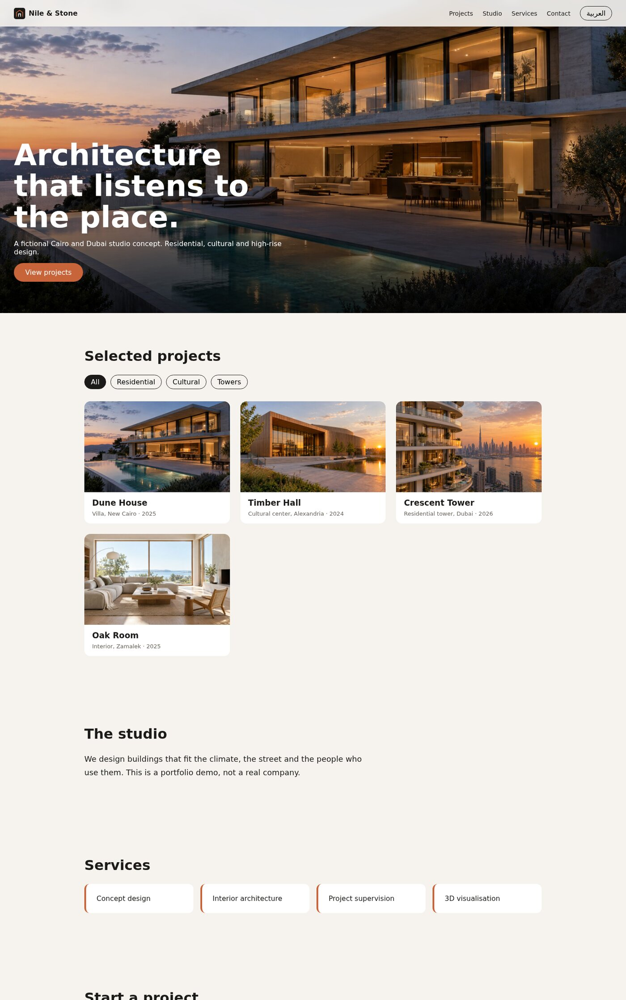
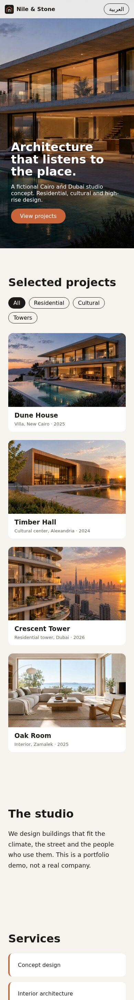

# Architecture Studio Website (React + Vite)

Bilingual (English / Arabic RTL) portfolio website for a fictional architecture studio.
Features: language toggle with RTL layout, project filters, details modal, responsive grid, contact form (demo, sends nothing).

Fictional brand. Images are AI-generated. Not a real company.

## Run
    npm install
    npm run dev
    npm run build

## Demo video
[docs/demo.mp4](docs/demo.mp4) (short screen recording of the main flows)

## Preview

## Highlights
- Arabic / English switch that flips the whole layout to RTL
- Category filters and a project details modal
- Responsive grid, lazy-loaded images, accessible alt text
- Plain React + Vite, no UI library
